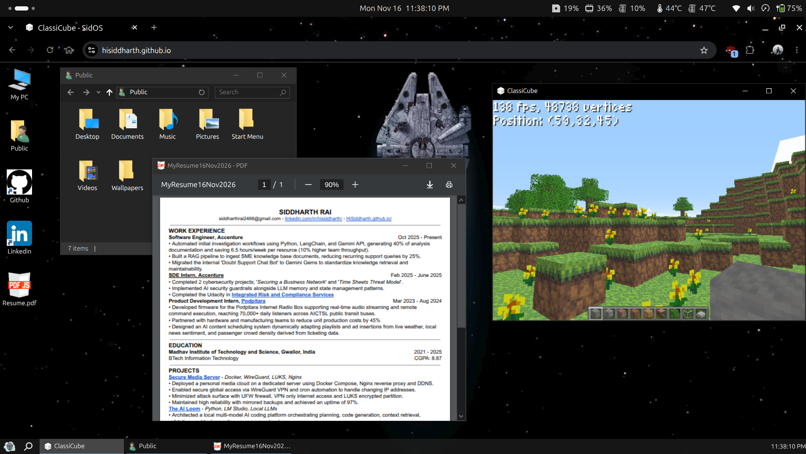

# ⚡ SidOS: Interactive Portfolio & Web Desktop

> **A browser-based operating system serving as my interactive personal portfolio.**

[](https://hisiddharth.github.io/)
[](https://github.com/HiSiddharth/HiSiddharth.github.io)
[](https://nextjs.org/)
[](https://github.com/DustinBrett/daedalOS)



---

## 💡 About This Project

**[Launch SidOS Live](https://hisiddharth.github.io/)**

Instead of a static webpage, SidOS lets you explore my projects, experience, and work as if you were browsing my personal desktop environment directly in your browser.

> **Attribution Note:**  
> The core web desktop engine is forked from the open-source [daedalOS](https://github.com/DustinBrett/daedalOS) project by **Dustin Brett**. I stripped down and customized the engine—removing heavy client-side emulators and WebGPU bloat while adding custom external routing, optimized live video wallpapers, and shader effects to repurpose it as a fast, lightweight portfolio.

---

## 🚀 Featured Work (On Desktop)

_(Project shortcuts and interactive showcases are currently being added to the desktop and will be listed here soon.)_

---

## 🛠️ Customizations Made for SidOS

- **Engineered External Link Routing:** Patched the OS execution pipeline (`useFile.ts`) with custom `BaseURL=External` logic to bypass `X-Frame-Options` restrictions and launch external project demos in native browser tabs.
- **Hardware-Decoded Live Wallpapers:** Transcoded and optimized 4K cinematic Star Wars video loops via FFmpeg (`-crf 26`, `-an` stripped audio, `-movflags +faststart` web-streaming headers), cutting file sizes by up to 90% for instant, bufferless playback.
- **Purged Heavy Bloat:** Excised dead-weight WebGPU models and legacy emulators (BoxedWine, V86, DX-Ball, client-side Stable Diffusion), significantly reducing bundle size, initial load time, and build overhead.
- **GLSL Shader Window Effects:** Enabled randomized window-closing animations inspired by _Burn-My-Windows_ (fire, glitch, and matrix fade shaders).

---

## 🖥️ Built-in OS Features

<details>
<summary><strong>Click to expand inherited desktop capabilities</strong></summary>

- **Virtual File System (`BrowserFS`):** Interactive file explorer with drag-and-drop uploads, IndexedDB persistence, archive extraction, and context menus.
- **Integrated Terminal (`xterm.js`):** Working shell environment with `git`, Python (`Pyodide`), and CLI utilities.
- **Built-in Apps:** **Monaco Editor** (VS Code's editor), **Webamp** (Winamp audio player), **Marked** (Markdown viewer for project docs), **PDF.js** (resume viewer), and **Paint**.
- **Window Management & Shortcuts:** Resizable/draggable windows, Start Menu (`SHIFT+ESC`), Search (`SHIFT+CTRL+S`), and Run dialog (`SHIFT+CTRL+R`).

</details>

---

## 💻 Tech Stack

- **Core Framework:** Next.js, React, TypeScript
- **Styling & Animation:** Styled-Components, Motion, GLSL Shaders
- **Virtual OS & Media:** BrowserFS, xterm.js, Monaco Editor, Webamp, FFmpeg (media optimization)

---

## 🏃 Running Locally

### Prerequisites

- [Node.js](https://nodejs.org/) 22+
- [Yarn](https://classic.yarnpkg.com/) (`corepack enable`)

### Setup

```bash
# Clone the repository
git clone https://github.com/HiSiddharth/HiSiddharth.github.io.git
cd HiSiddharth.github.io

# Install locked dependencies
yarn install

# Prebuild virtual filesystem & search indexes (re-run after modifying public/)
yarn build:prebuild

# Start development server
yarn dev

```

Open [http://localhost:3000](http://localhost:3000) in your browser.

---

## 📄 License & Credits

- **Base Desktop Environment:** Created by [Dustin Brett](https://github.com/DustinBrett) under the [MIT License](https://www.google.com/search?q=./LICENSE).
- **SidOS Customizations & Portfolio Content:** Maintained by **Siddharth Rai** ([Live Site](https://hisiddharth.github.io/) • [GitHub](https://github.com/HiSiddharth) • [LinkedIn](https://www.linkedin.com/in/hisiddharth/) • [Medium](https://hisiddharth.medium.com/)).
